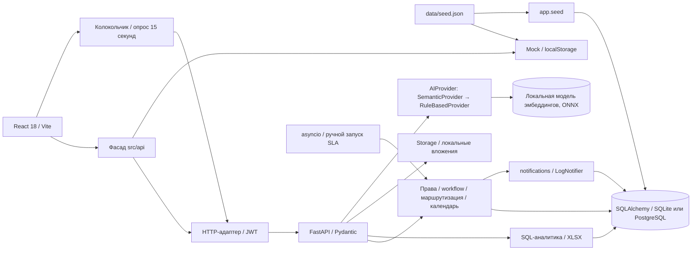
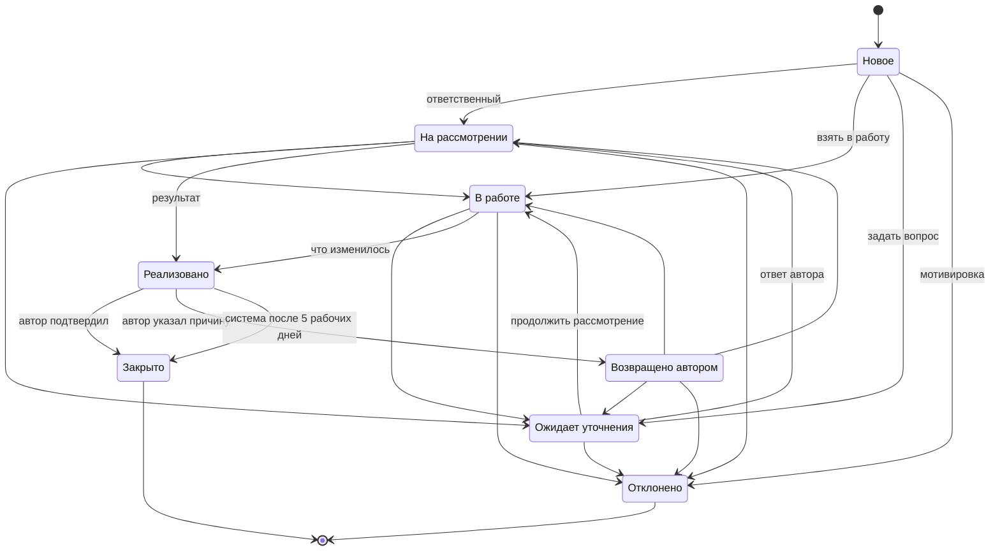

# Сигнал · Архитектура MVP

Система принимает проблемы, предложения и отзывы сотрудников, назначает ответственного, контролирует сроки и сохраняет результат. Frontend поддерживает HTTP по умолчанию и статический mock. В обоих режимах демо-источник один — `data/seed.json`: 20 исходных и 40 вручную написанных обращений, роли вместо персональных данных, относительные даты.

## Компоненты

FastAPI использует синхронные SQLAlchemy Session на запрос. Изменения обращения, аудит и внутрисистемные уведомления фиксируются одной транзакцией; завершение транзакции выполняется до отправки ответа через `Depends(..., scope="function")`. Это соответствует [жизненному циклу зависимостей FastAPI](https://fastapi.tiangolo.com/tutorial/dependencies/dependencies-with-yield/). Версия строки обращения защищает от потери конкурентных изменений: конфликт → 409 с предложением обновить карточку.

SLA проверяется одним процессом с настраиваемым интервалом `SLA_INTERVAL_SECONDS` (по умолчанию 60, минимум 5 секунд). Ручной запуск защищён правами администратора. Блокировка внутри процесса исключает одновременные ручную и фоновую проверки; ключи уведомлений предотвращают повторные напоминания по одному сроку. MVP рассчитан на один процесс планировщика, а не на несколько независимых worker-процессов.

## Данные

Справочник укрупнён до девяти категорий. Сопоставление старых названий хранится в `seed.json.categoryMap`; у каждого обращения сохранено `original_category`. Маршрутизация использует укрупнённую категорию. Начальные назначения A-001…A-020 и их исходные тексты/статусы сохранены; после запуска планировщик может штатно закрыть реализованные обращения без ответа автора.

Оценки потерь хранятся у автора и участников. `monthly_cost` пересчитывается при присоединении и используется SQL-агрегациями. Первый ответ хранит дату и рассчитанную длительность в рабочих часах, чтобы медиана и среднее вычислялись SQL-запросами. KPI, распределения, недельная динамика, кластеры, матрица и SLA выдаются готовыми агрегатами; детализация запрашивается отдельно с серверной проверкой области доступа и ограничением числа строк.

Миграции Alembic используют обычные таблицы, внешние ключи, индексы и ограничения SQLAlchemy, без диалектного SQL. SQLite — локальный вариант без Docker. `DATABASE_URL=postgresql+psycopg://...` переключает на PostgreSQL. PostgreSQL и compose в среде агента не запускались.

## Машина состояний

Единственный источник разрешённых переходов — `domain/workflow.py`. Вопрос, отказ, результат и причина возврата должны содержать минимум 10 символов. Нарушение перехода → 409. После реализации ответственному недоступно закрытие за автора. Возврат создаёт новый срок в пять рабочих дней; автоматическое закрытие не увеличивает число явных подтверждений авторами.

## Права

| Представление / действие | Сотрудник | Ответственный | Руководитель подразделения | Руководитель направления | Администратор |
| --- | --- | --- | --- | --- | --- |
| Полная карточка | Свои и присоединённые | Назначенные | Назначения своего подразделения | Свои назначения и эскалированные ему | Нет |
| Комментарии и вложения | В доступных карточках | В доступных карточках | В доступных карточках | В доступных карточках | Нет |
| Статусы, уточнение, переназначение | Нет | Назначенные | Своё подразделение | Назначенные и эскалированные | Нет |
| Подтверждение / возврат | Только автор своего | Нет | Нет | Нет | Нет |
| Похожие | Публичная сводка без переписки | Публичная сводка | Публичная сводка | Публичная сводка | Нет |
| Сделано | Публичный результат | Публичный результат | Публичный результат | Публичный результат | Публичный результат |
| Аналитика / Excel | Нет | Свои назначения | Своё подразделение | Вся компания с флагом | Только отдельные агрегаты без содержимого |
| Справочники / отпуск / маршруты / запуск SLA / сброс | Чтение нужных справочников | Чтение | Чтение | Чтение | Управление |

В UI ответственные и руководители объединены под ролью «Руководитель»; сервер различает `is_department_head` и `can_view_company_analytics`. Единственный пользователь с компанейской аналитикой в сиде — **Руководитель направления (`manager-2`)**. Администратор не получает содержимое даже по прямому ID. Переход из аналитической сводки «Открыть как ответственный» явно выполняет новый демо-вход.

## Назначение, календарь и SLA

Приоритет правил: категория + подразделение → категория → общее правило. Отпуск основного включает резервного. Если оба недоступны, назначается руководитель подразделения проблемы, затем руководитель направления; в аудит пишется назначение по резервному правилу. Отсутствие руководителей в повреждённой конфигурации блокирует регистрацию с 503, а не создаёт обращение без владельца.

Календарь РФ на 2026–2027 находится в `app/holidays.json`: праздники, перенесённые выходные и рабочая суббота 20 февраля 2027 года. Основания: [переносы 2026 года](https://static.government.ru/media/files/4jeB8hNKm69ggOa9yDiYOli6YoAyM21i.pdf), [официальное сообщение о календаре 2027 года](https://www.meteorf.gov.ru/press/newsactual/45104/). Календарь считает рабочие дни и часы 09:00–17:00 в `BUSINESS_TIMEZONE` (по умолчанию Europe/Moscow); сокращённые предпраздничные часы не моделируются.

За один рабочий день до срока система уведомляет ответственного. Просрочка первого ответа уведомляет руководителя подразделения и фиксируется в аудите. Просрочка решения больше трёх рабочих дней включает метку «Эскалировано» и уведомление руководителю направления; ему предоставляется доступ к эскалированной карточке. Реализация без реакции автора через пять рабочих дней закрывается как подтверждённая по умолчанию. Для демонстрации ждать не нужно: в исходном наборе есть старые открытые и реализованные обращения, а администратору доступен ручной запуск проверки.

## AI-слой

Все AI-функции скрыты за интерфейсом `AIProvider` (`backend/app/ai/provider.py`). Активен `SemanticProvider`; при недоступности модели он сам переходит на `RuleBasedProvider`, поэтому система работает и без модели, и без сети.

| Функция | Как работает | Где видно |
| --- | --- | --- |
| Поиск похожих | Локальная многоязычная модель эмбеддингов (`paraphrase-multilingual-MiniLM-L12-v2`, ONNX, CPU). Близость — косинус между вектором текста и векторами обращений. Находит перефразировки без общих слов. | Форма нового обращения |
| «Уже рассмотрено» | В выдачу попадают и закрытые обращения: с результатом («что изменилось») или причиной отказа. Автор видит, что вопрос уже решён, до отправки дубля. | Форма нового обращения |
| Автопривязка к кластеру | Новое обращение относится к повторяющейся проблеме с ближайшим центроидом, если близость выше порога; иначе — по ключевым словам. | Аналитика, карточка |
| Зарождающиеся проблемы | Обращения вне кластеров группируются по смыслу (связные компоненты по порогу). Руководитель направления оформляет группу в новый кластер. | Аналитика |
| Объяснимость | Каждое совпадение показывает процент близости и общие слова. Режим поиска подписан в интерфейсе (`GET /api/ai/status`). | Везде, где есть подсказка |

**Данные не покидают контур.** Модель выполняется на сервере приложения, обращения не передаются внешним сервисам. Для компании из отрасли безопасности это принципиально: в текстах встречаются сведения об объектах заказчиков.

Векторы лежат в таблице `ticket_embeddings` (float32, нормированы), пересчитываются при изменении текста (контроль по хешу) и при старте досчитываются в фоне. Пороги близости и имя модели задаются настройками (`SIMILAR_THRESHOLD`, `CLUSTER_THRESHOLD`, `EMBEDDING_MODEL`).

**Развитие:** `LLMProvider` для структуратора, черновиков ответов и еженедельного дайджеста — при наличии разрешённого компанией сервиса или локальной LLM; pgvector для масштаба.

## Безопасность и файлы

Демо-вход выдаёт JWT HS256 с `sub`, `iat`, `exp`, `iss`, `aud`; секрет читается из env. Без `JWT_SECRET` локально используется случайный секрет процесса, поэтому перезапуск требует повторного входа. Токен хранится в памяти frontend, права и текущая роль заново читаются из БД. Демо-вход публично позволяет выбрать любую демонстрационную роль: это сознательная замена SSO для показа, а не промышленная аутентификация.

Предметные изменения журналируются с автором, временем, старым и новым статусом/ответственным. Прямые запросы не обходят серверные права; 403, 409 и 422 возвращают короткие русские сообщения. Сервер не принимает автора из формы. Все значения в SQL параметризованы ORM; экспорт экранирует текст, который Excel мог бы принять за формулу.

Вложения до 10 МБ проходят проверку расширения (`pdf`, `png`, `jpg`, `docx`, `xlsx`, `txt`) и записываются потоково за интерфейсом `Storage`. Имя на диске — случайный ключ, исходное имя служит только отображению. До создания обращения скачать файл может только загрузивший сотрудник; после привязки действуют права карточки. Каталог не публикуется nginx. Скачивание идёт через проверяемый API с `nosniff`. `Storage.open/save` позволяет позже подключить S3, не меняя права и маршруты. Антивирус и анализ содержимого не входят в MVP; незакреплённые загрузки и файлы после сброса демо не удаляются автоматически.

`Notifier` отделяет уведомления в БД от внешних каналов. Сейчас `LogNotifier` только пишет в лог предполагаемую доставку; email и сообщения в Битрикс24 реально не отправляются.

В модели оставлены nullable `author_id` и `is_anonymous`. Анонимный вход не реализован. При последующем развитии потребуется отдельный высокоэнтропийный токен конверта (хеш в БД), права на чтение и ответ только владельцу токена, отдельная политика публикации и журнал без раскрытия личности. Подмена `authorId` или `isAnonymous` в текущем API запрещена схемой.

## План интеграций

| Система | Какие данные и направление | Способ | Что уточнить |
| --- | --- | --- | --- |
| Битрикс24: SSO | Идентификатор и проверенная роль из провайдера → Сигнал | Корпоративный OAuth/OIDC через согласованный шлюз | Поддерживаемый протокол конкретного портала, привязка учётных записей, отзыв доступа |
| AD | Корпоративная идентичность и группы → Сигнал через SSO-провайдер | OIDC/SAML-шлюз к AD | Доступный провайдер, MFA и правила групп |
| Битрикс24: оргструктура | Подразделения, руководители, замещения → Сигнал | REST, периодическая синхронизация и события изменений | Источник истины, идентификаторы подразделений, правила временного замещения |
| Битрикс24: уведомления | Ссылка на доступное обращение, срок и короткое событие Сигнал → мессенджер | REST/вебхук через адаптер Notifier | Права приложения, получатели, перечень разрешённых полей, повторная доставка |
| Битрикс24: задачи | Обращение и согласованное действие Сигнал → задача; состояние задачи → событие Сигнала | REST + подписанные входящие вебхуки | Кто владеет закрытием, защита от циклических обновлений, идемпотентные внешние ID |
| 1С: справочники | Активные сотрудники, роли и подразделения 1С → Сигнал | Согласованный HTTP-сервис/регламентный обмен | Какая конфигурация является источником кадровых данных, соответствие ID Битрикс24/AD, доступность поля отпуска |
| 1С: результат улучшения | Только утверждённый агрегат по улучшениям Сигнал → отчёт/регистр 1С, если нужен бизнесу | REST/регламентный пакет; очередь — последующий этап при необходимости гарантированной доставки | Состав агрегата, получатель и период; коммерческие документы и данные сделок не передавать без отдельного согласования |

План не предполагает передачи паролей, произвольных вложений и полной переписки в другие системы. Для реального обмена нужны сервисные учётные записи с минимальными правами, согласование схем, правил удаления и повторной доставки. Интеграции в этом этапе не исполняются.

## Ограничения MVP

Один процесс API/планировщика, локальное файловое хранилище и демонстрационная идентификация. Нет реальных интеграций, LLM, почты, очередей и распределённого планировщика. Генеративных функций (LLM) нет: структуратор и черновики ответов работают на правилах. Векторы хранятся в обычной таблице и сравниваются в памяти — этого достаточно для тысяч обращений; для больших объёмов предусмотрен переход на pgvector. Списки API имеют пагинацию, текущий UI загружает до 500 обращений, экспорт — до 50 000. Mock хранит предметные изменения в localStorage и не имитирует серверный планировщик; файлы mock живут до перезагрузки, XLSX требует HTTP. Docker и PostgreSQL требуют отдельной проверки развёртывания.
